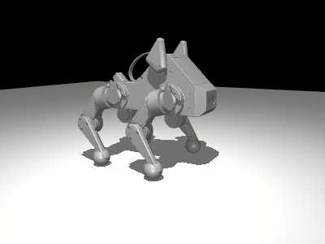

# The arrival bounce

Pupper's celebration when it reaches the survivor (`survivor-id/plan.md`, "Arrival"): three quick bounces up and down on the spot, then standing again. All four feet stay on the floor the whole time, and it does not travel.

**Status: designed and checked in simulation. Not trained yet, and never run on the robot.** Until a trained policy has passed the checks below and a TA has OK'd it, the arrival sequence uses the existing `push_up` trick as its stand-in.



## The motion

| | |
|---|---|
| Length | 2.9 s: 0.3 s standing, a dip, three bounces, a soft settle, 0.3 s standing |
| Body height | 116 mm at the bottom, 176 mm at the top (161 mm standing) |
| Tempo | 0.6 s per bounce |
| Nose | lifts 4° at the top of each bounce, level at the bottom |
| Feet | planted where Pupper stands, first frame to last |

Why it cannot hop: every stroke is slow enough that gravity alone stops the body at the top. Through the whole motion the feet carry at least 0.69 of the robot's weight (1.0 is standing still; 0 would be lift-off). `design.py` refuses to save a version where that drops below 0.5.

## Files

| File | What it is |
|---|---|
| `design.py` | The trick: keyframes and the constants that shape it. Run it in pupper-mjlab. |
| `bounce.npz` | The reference motion `design.py` produced. This is what training reads. |
| `bounce_preview.gif` | The reference played back with no physics, to judge the look. |
| `check_feet.py` | Physics replay that answers "did a foot leave the floor?", for plain replay or a trained policy. |
| `render_preview.py` | Makes the GIF. |
| `trick.yaml` | What the robot needs beside the trained `policy.json` (see step 5). |

## What has been checked (2026-11-23, pupper-mjlab `aa475e9`, on a CPU)

Design report (`design.py`):

| Line | Value | Good value |
|---|---|---|
| `max_ik_error_m` | 0.0 | under 0.002 |
| `lowest_foot_bottom_m`, `lowest_body_point_m` | 0.0 | 0 or above |
| `max_joint_speed_rad_s` | 7.48 | under about 15 |
| `fraction_of_joint_samples_at_limit` | 0.0 | 0 |
| `lowest_ground_load` | 0.69 | above 0.5 |
| `max_foot_movement_m` | 0.0 | 0 |

Physics replay, joints driven straight to the reference with no policy:

- `play_motion`: **WOBBLES** but stays up. The body lags the reference by up to 3.2 cm and tilts up to 2.1° off it. That is the expected result for plain replay (the course's own sit wobbles more before training), and the reason to train it.
- `check_feet.py`: **FEET STAY DOWN** on the nominal robot, on one 15 % heavier with its centre of mass 2 cm forward and 2 cm up (a guess at the cameras and mics), and on one 30 % heavier. No foot rose off the floor in any of them. The ball feet roll 12–23 mm as the legs bend and end within 3 mm of where they started.
- The training task (`Mjlab-Tracking-Flat-Pupper-v3`) loads `bounce.npz` and runs. Four iterations only, to see it start; that is not training.

Not done: training (it needs an NVIDIA GPU), and anything on the robot.

## To finish it

1. **Look at the preview.** To change the look, edit the constants at the top of `design.py` (`BOUNCES`, `DIP`, `RISE`, `NOSE_UP`, `STROKE_S`) and rerun:
   ```bash
   cd pupper-mjlab
   uv run python ~/sar-pupper/survivor-id/bounce/design.py ~/sar-pupper/survivor-id/bounce/bounce.npz
   MUJOCO_GL=egl uv run python ~/sar-pupper/survivor-id/bounce/render_preview.py ~/sar-pupper/survivor-id/bounce/bounce.npz ~/sar-pupper/survivor-id/bounce/bounce_preview.gif
   uv run python ~/sar-pupper/survivor-id/bounce/check_feet.py ~/sar-pupper/survivor-id/bounce/bounce.npz
   ```
   A faster or bigger bounce lowers `lowest_ground_load`. Keep it above 0.5.
2. **Train it**, the same way as lab 6's tricks (on Colab, `notebooks/CS123_Pupper_Tricks.ipynb` walks the same steps):
   ```bash
   uv run python -m mjlab.tasks.tracking.config.pupper.upload_motion ~/sar-pupper/survivor-id/bounce/bounce.npz --name bounce
   uv run train Mjlab-Tracking-Flat-Pupper-v3 --env.scene.num-envs 4096 --registry-name <entity>/mjlab/bounce
   ```
   A checkpoint is saved every 500 iterations. The course's sit was good after 500; this motion is simpler.
3. **Score the checkpoint** before it goes near the robot:
   ```bash
   uv run python -m mjlab.tasks.tracking.config.pupper.play_motion ~/sar-pupper/survivor-id/bounce/bounce.npz --checkpoint logs/rsl_rl/pupper_tracking/<run>/model_500.pt
   uv run python ~/sar-pupper/survivor-id/bounce/check_feet.py ~/sar-pupper/survivor-id/bounce/bounce.npz --checkpoint logs/rsl_rl/pupper_tracking/<run>/model_500.pt
   ```
   Wanted: **HOLDS UP** from the first and **FEET STAY DOWN** from the second. Run the second again with the head hardware's real weight once it has been weighed, e.g. `--mass-scale 1.15 --com-x 0.02 --com-z 0.02`. Policies are trained for a centre of mass up to 1 cm off, so a head that shifts it further is the case to look at.
4. **Get a TA's OK.** Course rule: a newly trained policy needs it before its first run on the robot.
5. **Put it on the robot**, in `gemini_pupper`:
   ```bash
   python3 robot/get_trick.py <entity>/mjlab/<run-id> --name bounce
   cp ~/sar-pupper/survivor-id/bounce/trick.yaml tricks/bounce/trick.yaml
   robot/stop.sh && robot/start.sh
   ```
   Copy `trick.yaml` only after `get_trick.py` has run. The robot reads `policy.json` for every `trick.yaml` at start-up, so a `trick.yaml` on its own stops the tricks loading.
6. **First run:** clear floor, nobody's feet nearby, a hand at the e-stop. The survivor node will play it through the robot server's `POST /animation` with `{"animation_name": "bounce"}`; the same call is the way to try it by hand.

## Limits

- **Pupper cannot dodge while it plays**: about 9 s in all (1.5 s hand-over to the trick, 2.9 s of bounce, about 4 s back to walking). See the plan's arrival section.
- **The simulated robot has no cameras, plate or mics on its head.** The checks above guess at them. Weigh the head hardware and rerun step 3 with real numbers.
- **Simulation only.** Sag, friction and motor heat on the real floor are untested.
- Once installed it is an ordinary trick, so off duty Gemini can play it on request.
